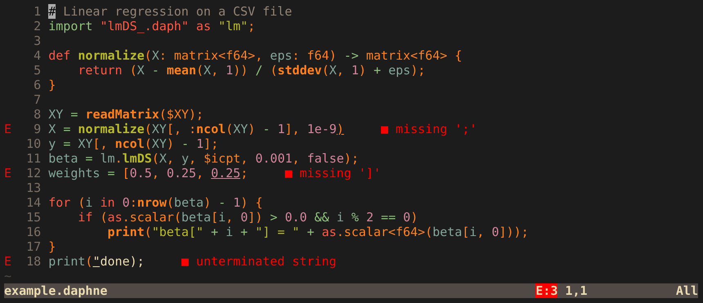
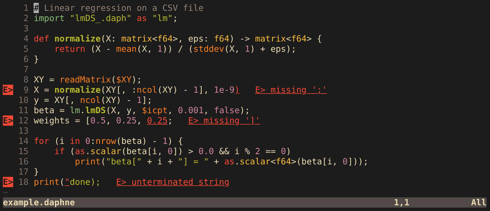
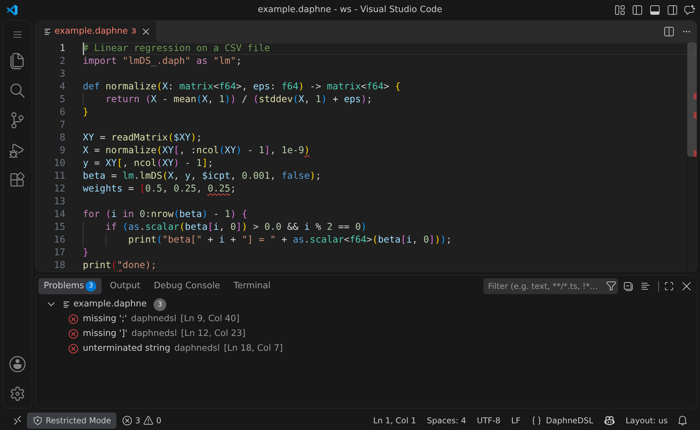

# daphne-lsp

Editor support for [DaphneDSL](https://github.com/daphne-eu/daphne), the language of the DAPHNE system (`.daphne` and `.daph` files): syntax highlighting, and syntax errors while you type, in Neovim, Vim and VS Code.

## Demo

The same script in each editor. It has three syntax errors: a missing `;` on line 9, an unclosed `[` on line 12, and an unterminated string on line 18.

**Neovim**



**Vim**



**VS Code**



The colors come from your own color scheme. The Neovim and Vim screenshots use the built-in `retrobox`, and the VS Code screenshot uses Dark Modern.

## What is in this repository

| Part | Where | Status |
| --- | --- | --- |
| Tree-sitter grammar | `grammar.js`, `src/` | Checked against DAPHNE's own ANTLR grammar |
| Neovim syntax highlighting | `queries/`, `ftdetect/`, `ftplugin/` | Works |
| Vim syntax highlighting | `syntax/`, `ftdetect/`, `ftplugin/` | Works |
| VS Code extension | `vscode/` | Works, not published to the Marketplace |
| Language server | `server/`, `plugin/` | Reports syntax errors in Neovim, Vim and VS Code |

## Installation

Open the section for your editor. Everything here was tested on Linux only.

<details>
<summary><b>Neovim</b></summary>

<br>

**Requirements**

| For | You need |
| --- | --- |
| Highlighting | A C compiler and `make`, to build the parser once |
| Syntax errors | Also Node.js, and Neovim 0.11 or newer |

**Install with lazy.nvim**

Highlighting and syntax errors:

```lua
{ 'khangkontum/daphne-lsp', build = 'make parser server' }
```

Highlighting only:

```lua
{ 'khangkontum/daphne-lsp', build = 'make' }
```

**Install with another plugin manager, or by hand**

Install the repository as a plugin, then run `make parser server` (or only `make`) in its directory. Without a plugin manager:

```sh
git clone https://github.com/khangkontum/daphne-lsp ~/.local/share/nvim/site/pack/plugins/start/daphne-lsp
cd ~/.local/share/nvim/site/pack/plugins/start/daphne-lsp
make parser server
```

`make server` runs `npm ci` and builds `server/dist/`. The first build downloads a WebAssembly toolchain, so it takes a while.

**Use**

Opening a `.daphne` or `.daph` file sets the filetype `daphnedsl`, starts tree-sitter highlighting, and starts the language server. Nothing needs to be configured, and nvim-treesitter is not required.

Neovim marks each error in the sign column and underlines it. To also show the message next to the line, as in the screenshot:

```lua
vim.diagnostic.config({ virtual_text = true })
```

Turn the language server off with `vim.lsp.enable('daphnedsl', false)`.

**Notes**

- Without the built parser, Neovim warns once and falls back to the regex highlighting that Vim uses.
- SQL inside `sql("...")` is highlighted when a tree-sitter parser for `sql` is installed.
- Tested with Neovim 0.12.6.

</details>

<details>
<summary><b>Vim</b></summary>

<br>

**Requirements**

| For | You need |
| --- | --- |
| Highlighting | `filetype plugin on` and `syntax on` in your vimrc. Nothing needs to be built |
| Syntax errors | Also Node.js, `make`, and an LSP client plugin: [yegappan/lsp](https://github.com/yegappan/lsp) or [vim-lsp](https://github.com/prabirshrestha/vim-lsp) |

**Install with vim-plug**

Highlighting and syntax errors:

```vim
Plug 'yegappan/lsp'
Plug 'khangkontum/daphne-lsp', { 'do': 'make server' }
```

Highlighting only:

```vim
Plug 'khangkontum/daphne-lsp'
```

**Install by hand**

```sh
git clone https://github.com/khangkontum/daphne-lsp ~/.vim/pack/plugins/start/daphne-lsp
cd ~/.vim/pack/plugins/start/daphne-lsp
make server   # only for syntax errors
```

`make server` runs `npm ci` and builds `server/dist/`. The first build downloads a WebAssembly toolchain, so it takes a while.

**Use**

Opening a `.daphne` or `.daph` file sets the filetype `daphnedsl` and highlights it. When the language server is built, the plugin registers it with whichever of the two LSP client plugins is installed. Nothing needs to be configured.

With yegappan/lsp, this shows the message next to the line, as in the screenshot:

```vim
autocmd User LspSetup call LspOptionsSet({'showDiagWithVirtualText': v:true, 'diagVirtualTextAlign': 'after'})
```

**Notes**

- Vim has no tree-sitter support, so it highlights with `syntax/daphnedsl.vim` (regular expressions). It does not highlight SQL inside `sql("...")`.
- Tested with Vim 9.1.

</details>

<details>
<summary><b>VS Code</b></summary>

<br>

**Requirements**

VS Code 1.91 or newer, and Node.js to build the extension. The extension is not on the Marketplace, so you build a `.vsix` file and install that.

**Install**

```sh
git clone https://github.com/khangkontum/daphne-lsp
cd daphne-lsp
npm ci
npm run build:vscode
cd vscode
npx @vscode/vsce package
code --install-extension daphnedsl-0.1.0.vsix
```

Instead of the last command, you can run "Extensions: Install from VSIX..." from the Command Palette.

**Use**

Opening a `.daphne` or `.daph` file highlights it and lists its syntax errors in the Problems panel (Ctrl+Shift+M). The extension runs the language server with the Node.js that is built into VS Code, and it also works in Restricted Mode.

**Notes**

- VS Code highlights with a TextMate grammar (regular expressions), not with the tree-sitter grammar, so it is less precise. For example, it cannot tell the `<` of `matrix<f64>` from a comparison.
- Tested with VS Code Server 1.146 in a browser, not with the desktop application.

</details>

<details>
<summary><b>Another editor with an LSP client</b></summary>

<br>

Build the language server with `make server` (it needs Node.js), then let your editor start it for DaphneDSL files with:

```sh
node /path/to/daphne-lsp/server/dist/server.cjs --stdio
```

This gives syntax errors only. Highlighting needs the tree-sitter grammar or the Vim syntax file from this repository.

</details>

## Language server

`server/` is a language server that parses each open document with the tree-sitter grammar (compiled to WebAssembly) and reports its syntax errors.

It reports syntax errors only: a missing `;`, an unclosed bracket, an unterminated string, tokens that do not belong. It does not know about names or types, so it accepts `x = undefinedVariable + "a";`. DAPHNE's own compiler finds those errors when the script runs.

The messages are not DAPHNE's messages. The error is usually reported on the same line as DAPHNE reports it, but one mistake can produce more than one error, and an error in the middle of a statement can be reported a few tokens away from the real mistake.

With several errors in one file, the parser sometimes cannot recover, and the server then reports only one of them. The others appear once that one is fixed.

## Limitations

- Highlighting does not report errors. The language server does, and only syntax errors.
- Built-in functions are a list of names (`data/builtins.txt`) taken from DAPHNE's source. A variable with the same name as a built-in is highlighted as a function only where it is called.
- One known difference from DAPHNE's parser: DAPHNE reads `]]` as a single token, so it rejects `X[, [0, 2]]` and wants `X[, [0, 2] ]`. This grammar accepts both.

## Development

```sh
npm install
npx tree-sitter generate              # after editing grammar.js
make                                  # builds parser/daphnedsl.so for Neovim
node scripts/update-builtins.mjs      # rewrites the built-in lists from data/builtins.txt
npm run build                         # builds the language server into server/dist/
npm test                              # tests the language server; run `npm run build` first
npm run typecheck
```

`npm test` runs the TypeScript tests directly with Node.js, which needs Node.js 22.18 or newer.

`node scripts/update-builtins.mjs --from <DAPHNE checkout>` refreshes `data/builtins.txt` from DAPHNE's source first.

### Conformance check

`conformance/check.py` parses every DaphneDSL script in a DAPHNE checkout, plus `conformance/cases/`, with both this grammar and a parser generated from DAPHNE's `DaphneDSLGrammar.g4`. Both must agree on which scripts are valid and must produce the same syntax nodes at the same positions. It needs Python and Java.

```sh
pip install -r conformance/requirements.txt
python conformance/check.py "$(conformance/fetch-daphne.sh)"
```

`conformance/DAPHNE_REF` pins the DAPHNE commit. To follow a newer DAPHNE, change it, run the check, and port any grammar changes that it reports.
